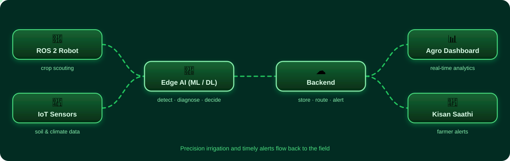
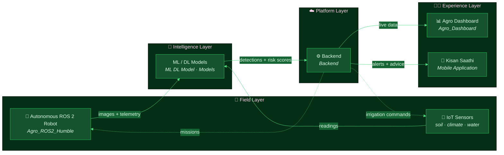
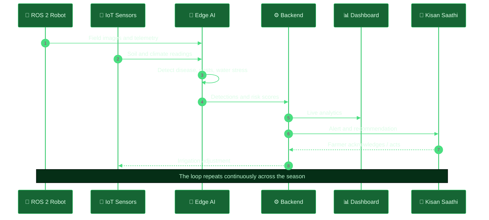
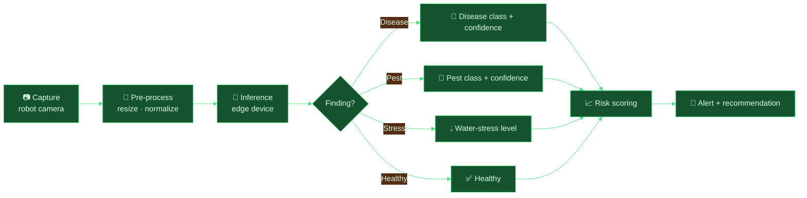
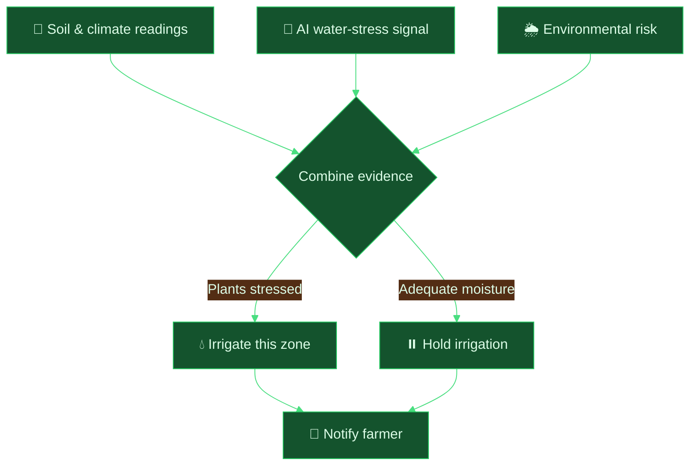

<div align="center">



<a href="https://github.com/AakashKavediya/F2F_SIH">
  
</a>

<br/>


**[Overview](#-overview) · [Features](#-key-features) · [Architecture](#-system-architecture) · [Modules](#-repository-structure) · [Getting Started](#-getting-started) · [Team](#-team-f2f--farm-to-future)**

</div>


## 📑 Table of Contents

- [🌾 Overview](#-overview)
- [🚨 The Problem](#-the-problem)
- [💡 Our Solution](#-our-solution)
- [✨ Key Features](#-key-features)
- [🏗️ System Architecture](#️-system-architecture)
- [📂 Repository Structure](#-repository-structure)
- [🧩 Module Deep Dive](#-module-deep-dive)
- [🔄 End-to-End Workflow](#-end-to-end-workflow)
- [🧠 AI / ML Pipeline](#-ai--ml-pipeline)
- [💧 Precision Irrigation Logic](#-precision-irrigation-logic)
- [🛠️ Tech Stack](#️-tech-stack)
- [🔌 Hardware](#-hardware)
- [🚀 Getting Started](#-getting-started)
- [🎯 Impact](#-impact)
- [🗺️ Future Scope](#️-future-scope)
- [🤝 Contributing](#-contributing)
- [👥 Team F2F – Farm to Future](#-team-f2f--farm-to-future)
- [📜 License](#-license)


## 🌾 Overview

**FarmerOS** is an **Edge-AI smart farming ecosystem** that joins an **autonomous ROS 2 robot**, **IoT sensors**, and **AI models** into one system that watches over a farm the way an experienced agronomist would, continuously and field by field.

The platform detects:

| 🔍 Detects | 🎯 Why it matters |
| :-- | :-- |
| 🦠 **Crop diseases** | Catch infections before they spread across the field |
| 🐛 **Pests** | Act early and target treatment instead of blanket spraying |
| 💧 **Water stress** | Irrigate exactly when and where plants need it |
| 🌦️ **Environmental risks** | Warn farmers before weather and soil conditions hurt the crop |

Insights reach the farmer in two ways: through a **real-time analytics dashboard** and through **Kisan Saathi**, a mobile application that delivers alerts and guidance directly to the farmer.

> [!NOTE]
> This repository is the complete FarmerOS monorepo: robot software, AI models, backend, web dashboard, mobile app and project documentation, all in one place.


## 🚨 The Problem

Farming still runs largely on manual inspection and guesswork, which leads to avoidable losses:

- 💦 **Water waste**: fields are irrigated on a schedule instead of on actual soil and plant demand.
- 💸 **High input costs**: chemicals and fertilizers are applied uniformly, even where they are not needed.
- 🌱 **Late detection**: diseases and pests are usually noticed only after visible damage has already spread.
- 📉 **Crop loss**: delayed decisions turn small, fixable problems into yield loss.
- 📵 **Information gap**: farmers rarely get timely, actionable, easy-to-understand advice.

## 💡 Our Solution

FarmerOS closes the loop from **sensing → understanding → acting → informing**:

```text
   SENSE                 UNDERSTAND              ACT                    INFORM
 ┌─────────┐          ┌──────────────┐      ┌───────────────┐      ┌───────────────┐
 │ ROS 2   │          │  Edge-AI     │      │  Precision    │      │ Dashboard +   │
 │ robot + │ ───────▶ │  disease /   │ ───▶ │  irrigation & │ ───▶ │ Kisan Saathi  │
 │ sensors │          │  pest / stress│      │  targeted care│      │ alerts        │
 └─────────┘          └──────────────┘      └───────────────┘      └───────────────┘
```


## ✨ Key Features

<table>
<tr>
<td width="50%" valign="top">

### 🤖 Autonomous Field Robot
- Built on **ROS 2 (Humble)**
- Navigates crop rows on its own
- Carries the camera and sensing payload to the plants, not the other way around

</td>
<td width="50%" valign="top">

### 🧠 Edge-AI Perception
- Vision models run **at the edge**, close to the crop
- Low latency, works with limited connectivity
- Disease, pest and stress detection in the field

</td>
</tr>
<tr>
<td width="50%" valign="top">

### 📡 IoT Sensor Network
- Continuous environmental and soil monitoring
- Complements the robot's visual scouting with ground-truth readings
- Feeds irrigation and risk decisions

</td>
<td width="50%" valign="top">

### 💧 Precision Irrigation
- Water where and when it is needed
- Reduces waste and lowers cost
- Driven by both sensor data and AI findings

</td>
</tr>
<tr>
<td width="50%" valign="top">

### 📊 Real-Time Analytics
- Live web dashboard (`Agro_Dashboard`)
- Field health, trends and alerts in one view
- Built for agronomists and farm operators

</td>
<td width="50%" valign="top">

### 📱 Kisan Saathi
- Farmer-facing mobile app
- Instant alerts and recommendations
- Turns complex analytics into simple actions

</td>
</tr>
</table>


## 🏗️ System Architecture

<div align="center">
  
</div>

<br/>



### 🧱 Layer Responsibilities

| Layer | Responsibility | Lives in |
| :-- | :-- | :-- |
| 🌾 **Field** | Collect images, telemetry and sensor readings; execute robot missions | [`Agro_ROS2_Humble`](./Agro_ROS2_Humble) |
| 🧠 **Intelligence** | Detect disease, pests, water stress and risk | [`ML DL Model`](./ML%20DL%20Model) · [`Models`](./Models) |
| ☁️ **Platform** | Ingest, store, process and distribute data and alerts | [`Backend`](./Backend) |
| 👨‍🌾 **Experience** | Show analytics and deliver alerts to people | [`Agro_Dashboard`](./Agro_Dashboard) · [`Mobile Application`](./Mobile%20Application/kisan-saathi) |
| 📚 **Docs** | Project documentation and design material | [`FarmerOS - Documentation`](./FarmerOS%20-%20Documentation) |


## 📂 Repository Structure

```text
F2F_SIH/
├── 🤖 Agro_ROS2_Humble/              # ROS 2 Humble workspace: autonomous robot software
├── 📊 Agro_Dashboard/                # Real-time analytics dashboard
├── ⚙️  Backend/                       # Server-side services, APIs and data handling
├── 🧠 ML DL Model/                   # Model development, training and experiments
├── 📦 Models/                        # Trained / exported model artifacts
├── 📱 Mobile Application/
│   └── kisan-saathi/                 # Kisan Saathi farmer app
├── 📚 FarmerOS - Documentation/      # Project documentation
├── 🚫 .gitignore
├── 📜 LICENSE                        # MIT
└── 📄 README.md                      # You are here
```

| Folder | Purpose | Jump |
| :-- | :-- | :-: |
| `Agro_ROS2_Humble` | Autonomous robot software on ROS 2 Humble | [➡️](./Agro_ROS2_Humble) |
| `Agro_Dashboard` | Real-time analytics and monitoring UI | [➡️](./Agro_Dashboard) |
| `Backend` | Services and APIs connecting every component | [➡️](./Backend) |
| `ML DL Model` | Machine-learning and deep-learning work | [➡️](./ML%20DL%20Model) |
| `Models` | Model files used by the system | [➡️](./Models) |
| `Mobile Application/kisan-saathi` | Farmer-facing mobile app | [➡️](./Mobile%20Application/kisan-saathi) |
| `FarmerOS - Documentation` | Documentation and design material | [➡️](./FarmerOS%20-%20Documentation) |


## 🧩 Module Deep Dive

<details open>
<summary><b>🤖 Agro_ROS2_Humble: Autonomous Robot</b></summary>

<br/>

The robot is the eyes of FarmerOS. It is developed as a **ROS 2 Humble** workspace, so functionality is split into independent, reusable nodes that communicate over topics, services and actions.

**Typical responsibilities of the robot stack**

- 🧭 **Navigation**: moving along crop rows and covering the field
- 🌐 **Perception**: camera and range sensing to observe plants and surroundings
- 📡 **Telemetry**: publishing sensor and status data
- 🔗 **Integration**: handing images and readings over to the AI and backend layers

**Why ROS 2?** Modular nodes, well-defined message interfaces, strong tooling for simulation and debugging, and a large ecosystem for navigation and sensing.

</details>

<details>
<summary><b>🧠 ML DL Model & Models: AI Brain</b></summary>

<br/>

Home of the machine-learning and deep-learning work that turns raw images and readings into decisions.

- 🦠 **Disease detection** on crop imagery
- 🐛 **Pest detection**
- 💧 **Water-stress assessment**
- 🌦️ **Environmental-risk analysis**

`ML DL Model` holds the development side (experiments and training), while `Models` holds the model artifacts used by the running system. The models are designed for **Edge-AI** deployment, running near the crop so that results are fast and do not depend on constant connectivity.

</details>

<details>
<summary><b>⚙️ Backend: Data & Alerts Hub</b></summary>

<br/>

The backend is the connective tissue of the platform.

- 📥 Receives detections, telemetry and sensor readings
- 🗄️ Stores and organizes field data
- 📤 Serves live data to the dashboard
- 🔔 Triggers alerts and advice for Kisan Saathi
- 💧 Supports irrigation decisions

</details>

<details>
<summary><b>📊 Agro_Dashboard: Real-Time Analytics</b></summary>

<br/>

A monitoring interface for agronomists and farm operators.

- 📈 Live field-health and sensor trends
- 🚨 Active alerts and detections
- 🗺️ Field-level overview of where attention is needed
- 💧 Water usage and irrigation insight

</details>

<details>
<summary><b>📱 Kisan Saathi: Farmer's Companion</b></summary>

<br/>

*Kisan Saathi* (किसान साथी) means **"the farmer's companion."** It puts the platform's intelligence into a farmer's pocket.

- 🔔 Timely alerts about disease, pests, water stress and environmental risk
- 🌱 Clear, actionable recommendations
- 📲 Simple, farmer-first experience

</details>

<details>
<summary><b>📚 FarmerOS - Documentation</b></summary>

<br/>

Project documentation, design material and supporting write-ups for FarmerOS.

</details>


## 🔄 End-to-End Workflow



1. 🚜 The **robot** patrols the field while **IoT sensors** stream ground-level data.
2. 🧠 **Edge AI** analyses what was captured and flags problems.
3. ⚙️ The **backend** stores results and evaluates what needs to happen next.
4. 📊 The **dashboard** shows the live picture.
5. 📱 **Kisan Saathi** notifies the farmer with a clear next step.
6. 💧 **Irrigation** is adjusted based on real need.


## 🧠 AI / ML Pipeline



| Stage | What happens |
| :-- | :-- |
| 📷 **Capture** | The robot collects imagery while moving through the crop rows |
| 🧹 **Pre-process** | Images are prepared for the model |
| 🧠 **Inference** | Models run on the edge for fast, local decisions |
| 📈 **Risk scoring** | Findings combine with sensor context into a risk level |
| 🔔 **Alerting** | The farmer gets a clear, prioritized message |


## 💧 Precision Irrigation Logic

Irrigation is decided from **evidence**, not from a timer.



**Result:** less water waste, lower cost, and healthier crops.


## 🛠️ Tech Stack

<div align="center">

| Domain | Technologies |
| :-- | :-- |
| 🤖 **Robotics** | ROS 2 Humble |
| 🧠 **AI / ML** | Deep learning · Computer vision · Edge inference |
| 📡 **IoT** | Sensor network · ESP32 · MQTT |
| ⚙️ **Backend** | Server-side services and APIs |
| 📊 **Web** | Real-time analytics dashboard |
| 📱 **Mobile** | Kisan Saathi application |
| ☁️ **Cloud** | AWS |

</div>

> [!TIP]
> Each module keeps its own dependency manifest inside its folder, so check that folder for the exact versions and libraries it uses.


## 🔌 Hardware

| Component | Role |
| :-- | :-- |
| 🖥️ **Raspberry Pi 5** | Onboard compute for the robot and edge processing |
| 🔧 **ESP32** | Microcontroller for sensor nodes and IoT connectivity |
| 📡 **LiDAR** | Range sensing for navigation and obstacle awareness |
| 📷 **Camera** | Crop imagery for AI detection |
| 🌡️ **Soil / climate sensors** | Ground-truth data on moisture and environment |
| 🚜 **Mobile robot base** | Carries the payload through crop rows |


## 🚀 Getting Started

### ✅ Prerequisites

| Requirement | Used for |
| :-- | :-- |
| 🐧 Ubuntu 22.04 | Native platform for ROS 2 Humble |
| 🤖 ROS 2 Humble | Robot workspace |
| 🐍 Python 3 | ML and robot nodes |
| 🟢 Node.js and a package manager | Dashboard and mobile app |
| 🔀 Git | Cloning the repository |

### 1️⃣ Clone the repository

```bash
git clone https://github.com/AakashKavediya/F2F_SIH.git
cd F2F_SIH
```

### 2️⃣ Build the robot workspace

```bash
source /opt/ros/humble/setup.bash
cd Agro_ROS2_Humble
rosdep install --from-paths . --ignore-src -r -y
colcon build --symlink-install
source install/setup.bash
```

### 3️⃣ Run the backend, dashboard and mobile app

Each of these modules is self-contained. Open its folder, install the dependencies listed in that folder's manifest, and start it with the run script defined there.

```bash
cd Backend                              # then: install deps and start the server
cd Agro_Dashboard                       # then: install deps and start the dev server
cd "Mobile Application/kisan-saathi"    # then: install deps and start the app
```

### 4️⃣ Use the AI models

The trained artifacts are in [`Models`](./Models), and the development work is in [`ML DL Model`](./ML%20DL%20Model).


## 🎯 Impact

<div align="center">

| 💧 | 💸 | 🌱 | 👨‍🌾 |
| :-: | :-: | :-: | :-: |
| **Less water waste** | **Lower input costs** | **Fewer crop losses** | **Better decisions** |
| Irrigation driven by real need | Targeted care instead of blanket treatment | Problems caught early | Clear guidance through Kisan Saathi |

</div>

## 🗺️ Future Scope

- [ ] 🌍 Multilingual support in Kisan Saathi
- [ ] 🔌 Offline-first mode for low-connectivity farms
- [ ] 🐝 Multi-robot fleet coordination
- [ ] 🌾 Support for additional crops and disease classes
- [ ] 🛰️ Integration with satellite and weather data
- [ ] 📈 Yield prediction


## 🤝 Contributing

Contributions are welcome! 🌱

1. 🍴 **Fork** the repository
2. 🌿 Create a branch: `git checkout -b feature/amazing-feature`
3. 💾 Commit your changes: `git commit -m "Add amazing feature"`
4. 🚀 Push the branch: `git push origin feature/amazing-feature`
5. 🔁 Open a **Pull Request**

## 👥 Team F2F – Farm to Future


## 📜 License

Distributed under the **MIT License**. See [`LICENSE`](./LICENSE) for details.

<div align="center">

<br/>

### 🌱 *From Farm to Future* 🌱


**If FarmerOS helps you, drop a ⭐ on the repo.**

</div>
